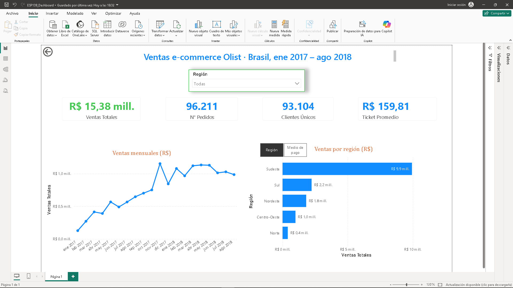

# Del ETL al dashboard: ventas e-commerce Olist (Power BI)

Proyecto del ramo **Herramientas de Software para el Análisis de Datos (ESP139)**, Ingeniería en Ciencia de Datos, Escuela de Comercio de Santiago (2026).

Toma tres fuentes públicas del e-commerce brasileño Olist, las limpia e integra con Python (pandas) y Power Query, y las presenta en un dashboard de Power BI con KPIs de ventas, tendencia mensual y comparación por región y medio de pago.

## Resultados

| KPI (ene 2017 - ago 2018) | Valor |
|---|---|
| Ventas totales | R$ 15,38 millones |
| Pedidos | 96.211 |
| Clientes únicos | 93.104 |
| Ticket promedio | R$ 159,81 |

Hallazgos principales (detalle en [Seccion5_Analisis.md](Seccion5_Analisis.md)):
- Las ventas crecieron con fuerza en 2017, con un peak en noviembre por el Black Friday, y se estancaron en torno a R$ 1 millón mensual en 2018.
- El Sudeste concentra el 64,6 % de las ventas, pero el Norte y el Nordeste tienen el ticket promedio más alto.
- Solo el 3 % de los clientes compró más de una vez: hay una oportunidad clara en fidelización.

## Proceso

1. **Extracción:** pedidos, clientes y pagos (3 CSV de Olist). Ver [datos_publicos/LEEME_Olist.md](datos_publicos/LEEME_Olist.md).
2. **Limpieza y transformación:** [limpieza_olist.py](limpieza_olist.py). Filtra pedidos entregados y el periodo completo, descarta pagos inválidos, normaliza fechas y textos, crea la columna Región y deja un registro de cada paso con filas antes y después ([datos_limpios/registro_limpieza.md](datos_limpios/registro_limpieza.md)). Las decisiones y supuestos están en [Seccion3_Decisiones.md](Seccion3_Decisiones.md).
3. **Modelo y dashboard:** [ESP139_Dashboard.pbix](ESP139_Dashboard.pbix), con tabla calendario y medidas DAX (ventas, pedidos con `DISTINCTCOUNT`, clientes únicos con `customer_unique_id`, ticket promedio).

`generar_datos.py` y la carpeta `datos/` contienen un set ficticio con errores sembrados que usé para practicar la limpieza antes de pasar a los datos reales.

## Cómo reproducirlo

1. Descarga los CSV de Olist (enlace en `datos_publicos/LEEME_Olist.md`) y déjalos en `datos_publicos/`.
2. Ejecuta `python limpieza_olist.py`. Genera `datos_limpios/olist_ventas_limpio.xlsx`.
3. Abre `ESP139_Dashboard.pbix` en Power BI Desktop.

## Herramientas

Python (pandas), Power BI Desktop (Power Query, DAX), Excel.

## Fuente de datos

Olist (2018). *Brazilian E-Commerce Public Dataset by Olist*. Kaggle. https://www.kaggle.com/olistbr/brazilian-ecommerce. Licencia CC BY-NC-SA 4.0.

---
Javier Molina · [GitHub](https://github.com/Kladyuz) · [LinkedIn](https://linkedin.com/in/javier-molina-data)
